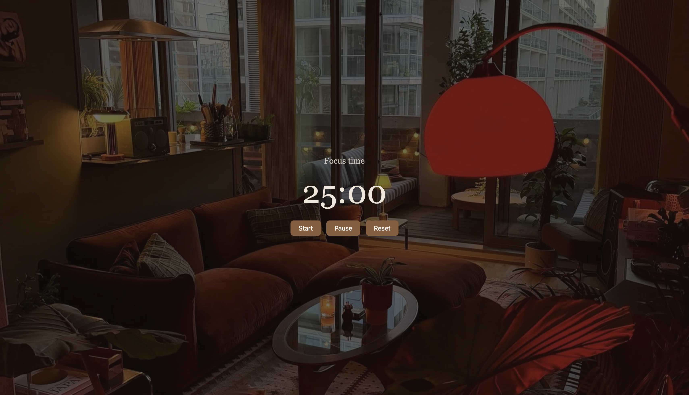
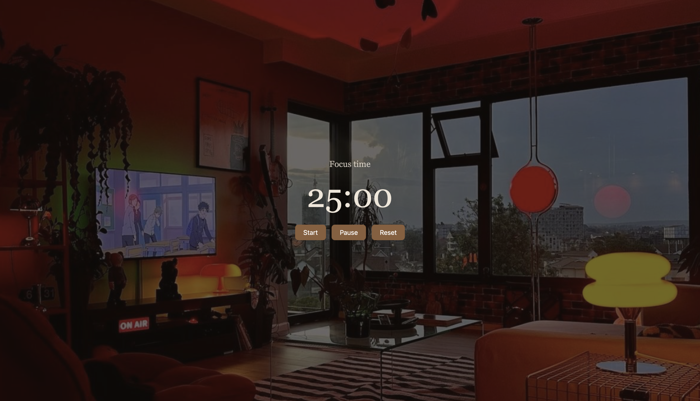
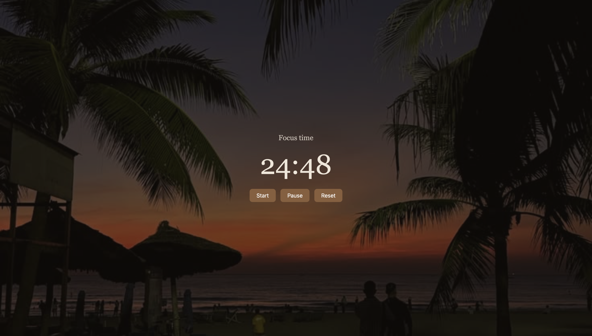

# Pomodoro Timer

A simple Pomodoro timer built with HTML, CSS and JavaScript to help me study in focused sessions.
https://shreyadebnath242-blip.github.io/pomodoro-timer/

## Features
- 25-minute focus sessions and 5-minute breaks, switching automatically
- Start, Pause and Reset buttons
- Time is also shown in the browser tab title
- Dark academia colour theme

## Screenshots

## How to run
Download `index.html` and open it in any browser. No installation needed.

## What I learned
- Using `setInterval` and `clearInterval` for timers
- Updating the page with JavaScript (DOM manipulation)
- Styling with Flexbox in CSS

## Future improvements
- Sound alert when a session ends
- Custom focus and break lengths
- A session counter
